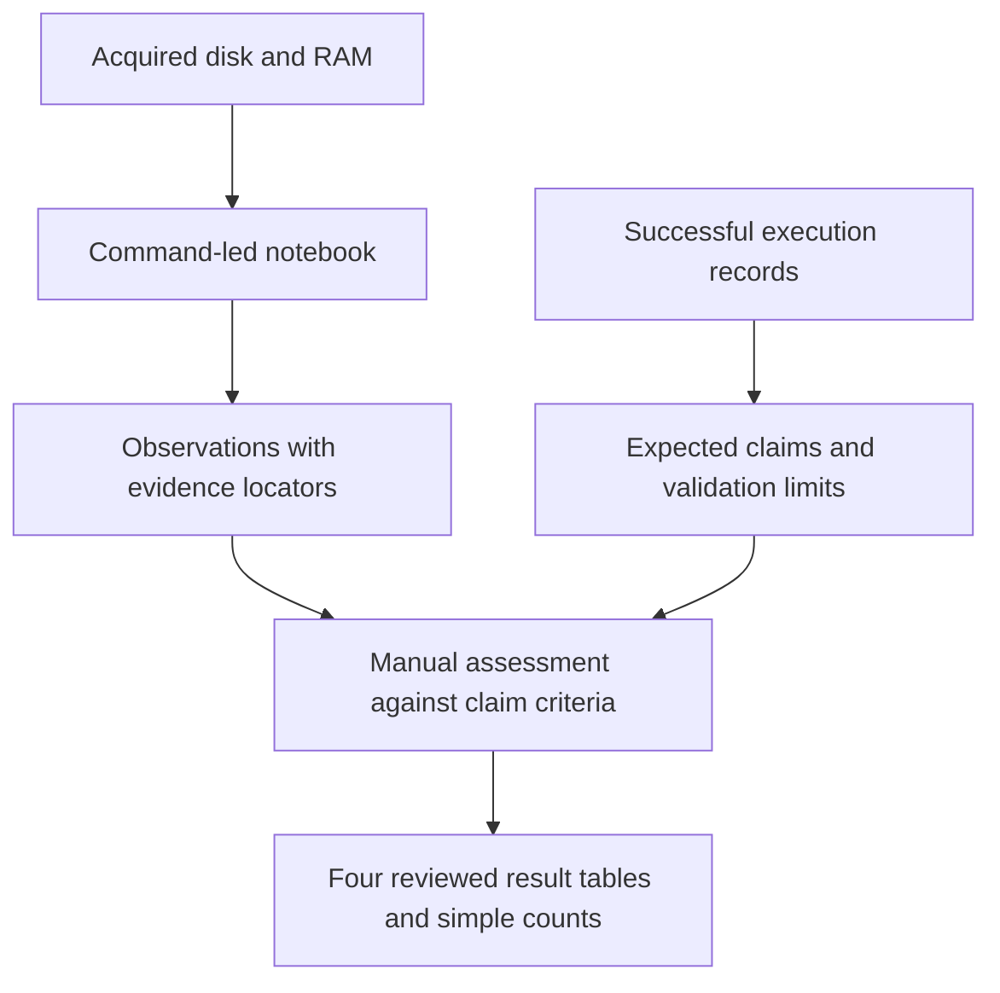

# Investigation design draft — 6 October 2026

Recommendation: keep Jupyter with the existing Python/IPython kernel, write forensic
commands in Bash cells, and reserve Python for useful table operations and final
counts. Use a small manual assessment file. Preparation remains an activity; the
current `prepare.py` does not need to be the entry point for every investigation.

This is a design proposal for the provisional thesis due 29 October: at least three
complete scenarios, initially on one reference OS each. It does not change the
current rules, notebook, evidence, claim definitions or accepted results. In
particular, CSV findings and optional use of `prepare.py` would replace existing
implementation decisions only when this design is adopted.



The execution record supplies the experimental reference. It is kept separate
from observations recovered from the acquired evidence.

## 1. Choose the notebook without building another command framework

| Option | Benefit | Cost | Decision |
|---|---|---|---|
| Python/IPython kernel with `%%bash` | Commands, outputs and reasoning together; existing installation; ordinary Python tables when useful | Each Bash cell starts a new shell | Recommended, with explicit shared parameters |
| Bash kernel | Normal shell syntax and persistent shell state | Another kernel to install and maintain; Python table work becomes less convenient | Viable, unnecessary for this draft |
| Terminal and Markdown | Familiar CLI workflow with very little infrastructure | More manual work attaching outputs and keeping the report synchronized | Practical fallback |

All three can support a defensible study. The scientific contribution comes from
the experimental design, observations and evaluation criteria, not the editor.

**Local feasibility checked:** the installed IPython 9.16.1 passes `%env` values
and the `%cd` directory into subsequent Bash cells. A variable assigned or exported
inside one Bash cell does not reach the next. A nonzero command exit is surfaced
as a cell error. These were small environment probes, not a replay of the
investigation. The behavior is documented in
[IPython's magics reference](https://ipython.readthedocs.io/en/stable/interactive/magics.html).

Keep the language boundary simple:

- Bash invokes forensic tools and performs short, readable text searches.
- Tools retain their native text, CSV, bodyfile, JSONL or binary outputs.
- Python reads those files only when a table/filter/count is clearer in Python.
- The analyst writes interpretations and assigns statuses.

Avoid both Python command wrappers and long shell pipelines that implement a new
parser. A short dataframe selection is preferable to complicated CSV parsing in
`awk`. Existing useful readers can remain until there is a concrete reason to
replace them.

## 2. What the notebook looks like

| Section | Questions and work | Typical interfaces |
|---|---|---|
| 0. Evidence | Which run and images? Acquisition intervals, integrity, tool versions, symbols, clock semantics, prior knowledge and scope | Existing manifests and verification records; small setup cell |
| 1. Disk Forensics | Which filesystem? Which entries and metadata survive? Can a justified deleted object be recovered? | `mmls`, `fsstat`, `fls`, `istat`, `icat`; bounded recovery subsection |
| 2. Linux Forensics | What do accounts, persistence configuration, services, logins, logs, history and staging locations show? | Targeted extraction; `last`; text searches; `journalctl` on extracted journals |
| 3. Memory Forensics | Which processes, mappings, sockets and modules exist? What retained content answers unresolved questions? | Selected Volatility 3 plugins, invoked when their question arises |
| 4. Timeline Analysis | What order and timing can the observed records establish? Where do timestamps or captures disagree? | Existing Plaso export, scoped `mactime`, selected event correlation |
| 5. Results | What supports each claim, what remains missing, and what did combination add? | Manual assessment and the four existing tables |

Disk and Linux are separate narrative sections over the same disk acquisition.
Timeline is an analysis view. Those headings do not create independent evidence
origins. Cross-reference an earlier output instead of extracting it again just
because another section uses it.

Every investigation block follows this pattern:

**Question → documented technique → command → actual output → observation →
interpretation and limitation → justified next pivot.**

### Example: shared setup

One IPython cell selects the case directory and parameters:

```ipython
%cd /home/anto/linux-multisource-dfir-lab/shared/experiments/father-u22-20260913-01
%env TZ=UTC
%env DFIR_IMAGE=dumps/disk/evidence_disk.E01
%env DFIR_MEMORY=dumps/memory/mem.raw
%env DFIR_SYMBOLS=/home/anto/linux-multisource-dfir-lab/shared/isf
```

After examining the partition table and confirming the filesystem, record the
observed offset in a later IPython cell:

```ipython
%env DFIR_OFFSET=227328
```

This offset belongs to Father. Reusing the structure for another run does not
reuse its offsets, inodes, PIDs or interpretations. Shared values use `%env`;
temporary values remain local to the command cell. Do not mix Python variable
interpolation with shell expansion.

### Example: a Linux persistence block

**Question:** What does the preload configuration contain, and what does that
establish at disk acquisition? This block follows a persistence inventory that
identified the path and a lookup that returned inode 74252.

First command cell:

```bash
%%bash
istat -z UTC -o "$DFIR_OFFSET" "$DFIR_IMAGE" 74252
```

Second command cell:

```bash
%%bash
icat -o "$DFIR_OFFSET" "$DFIR_IMAGE" 74252
```

The technique is ordinary metadata examination and file-content extraction,
documented by the [TSK istat manual](https://www.sleuthkit.org/sleuthkit/man/istat.html)
and [icat manual](https://www.sleuthkit.org/sleuthkit/man/icat.html).

Existing Father transcripts record an allocated inode of size 17 and content
`/lib/selinux.so.3`. The commands above illustrate the proposed presentation;
they were not re-executed for this design.

**Draft observation:** The disk copy of `/etc/ld.so.preload` names
`/lib/selinux.so.3`.

**Interpretation and limit:** This records loader configuration at disk acquisition.
It does not, by itself, establish loading into a particular process, the original
write time, or who wrote it. The next relevant question is whether the referenced
object exists and what process mappings show. This example assigns no claim status.

The underlying record remains locatable through the existing
[metadata transcript](/home/anto/linux-multisource-dfir-lab/shared/experiments/father-u22-20260913-01/investigation/output/s1-04-preload-istat.txt)
and [content transcript](/home/anto/linux-multisource-dfir-lab/shared/experiments/father-u22-20260913-01/investigation/output/s1-04-preload-icat.txt).

### Example: a larger memory result

Keep a short result directly in the executed notebook. For a larger table, save
the tool's own serialization and stderr in the existing run-local output folder:

```bash
%%bash
vol3 -q -f "$DFIR_MEMORY" -s "$DFIR_SYMBOLS" -r csv linux.proc.Maps \
    > investigation/output/manual-maps.csv \
    2> investigation/output/manual-maps.stderr.txt
```

Inspect stderr and display a relevant view in subsequent cells. Volatility already
has a [native CSV renderer](https://volatility3.readthedocs.io/en/latest/_modules/volatility3/cli/text_renderer.html);
there is no need to flatten its JSON merely to obtain a table. Existing prepared
JSON remains usable; changing formats is not a reason to repeat an examination.

Prefer one forensic invocation per cell so its exit status remains visible. In
the local probe, `false | cat` masked failure, while `set -o pipefail` exposed it.
Use that option when a pipeline needs it. A search with no matches and a tool
failure need different interpretations; do not suppress every nonzero status.

Retain small outputs in the saved executed notebook and large/binary outputs in
the case directory. Before freezing a completed notebook, separately select a
fresh-kernel replay and review its outputs for stale state and expected failures.

## 3. Preparation and formats

Preparation is useful when it avoids repeating expensive work. It does not need
to discover every artifact or run every plugin before examination starts.

| Work | Proposed placement |
|---|---|
| Evidence identity, integrity and tool/symbol versions | Establish and record once for the case; reference in Evidence |
| `mmls`, `fsstat`, targeted `fls`, `istat`, `icat` | Direct notebook commands |
| Process, mapping, socket and module plugins | Direct when needed; retain outputs that will be reused |
| Full page-cache enumeration | Generate once when its question arises, then reuse |
| Plaso extraction and full export | Separate recorded preparation, outside routine notebook replay |
| Interpretation and claim support | Manual examination and Results; never preparation |

Father's existing preparation log records roughly 7 seconds for `pslist`, 13 for
`psscan`, 23 for maps, 77 for page-cache enumeration, and 384 for Plaso extraction.
These are historical timings for this run, not performance guarantees or
time-to-detect measurements. They support starting ordinary plugins directly and
saving their outputs when useful.

**For Father, reuse the existing preparation products, especially the canonical
Plaso JSONL.** For later cases, a few documented preparation commands may be
sufficient. There is no immediate need to rewrite `prepare.py`, replace it with a
second framework, or normalize every tool into one data model.

Keep TSK text/bodyfiles, Volatility native text or CSV for new outputs, Plaso
JSONL, and extracted bytes in their original form. Preserve raw output before
filtering and identify the full record behind any displayed excerpt. Retain
Plaso `filestat` in the canonical export; filtering is an explicit analysis view.

## 4. Collect results with a small manual record

Proposed run-local file: `investigation/findings/assessment.csv`, containing the
existing six finding fields:

```text
claim_id,source,status,locator,observation,limitation
```

One row represents the analyst's resolved assessment of one claim/source pair.
Father therefore has 21 assessments for seven claims and three source columns.
The notebook retains individual attempts, their command outputs, record origins
and reasoning; the CSV locator points back to them. Multiple tool hits do not
become multiple claims. Do not copy historical proposed statuses as accepted facts.

Keep the existing statuses: `supported`, `partial`, `unsupported`,
`not_applicable`, `not_examined`, `tool_failure`. An uncompleted examination is
not an unsupported claim. Status assignment and acceptance remain human work.

Python can check duplicate pairs, unknown IDs/statuses and missing assessments,
then count ratings or display the source grid. Start with ordinary manual tables
for the selected chronology, combined reasoning and footprint. Automating all
four tables is not a prerequisite; any manually assembled summary must agree
with the assessment file before acceptance.

| Existing result table | Content and authorship |
|---|---|
| Reconstructed chronology | Analyst selects events, time semantics, locators and uncertainties |
| Claim coverage and source support | Source ratings from assessments; analyst supplies combined conclusion and missing elements |
| Multi-source contribution | Simple counts of reviewed sufficient, corroborated, jointly sufficient and unresolved claims |
| Explored footprint inventory | Analyst identifies relevant objects and deduplicates them before counting |

The evidence, transcripts, assessments and tables remain in the existing run
directory. Freeze the reviewed notebook and the outputs it cites. The repository
can retain a clean scenario template; each run keeps its own narrative and results.

## 5. What makes this an empirical study

A small controlled case study can produce scientific results through manual
examination. Define the tested conditions and expected claims, preserve the
evidence, apply explicit assessment criteria, and report observations and limits
that another examiner can inspect. NIST's
[CFTT program](https://www.nist.gov/itl/csd/secure-systems-and-applications/computer-forensics-tool-testing-program-cftt)
likewise emphasizes procedures, criteria and test sets for tool evaluation. That
is a methodological reference, not certification of this proposed study.

Use bounded versions of the supervisor's questions:

| Research question | Result available from this design | Boundary |
|---|---|---|
| Which disk and memory artifacts are observable in the selected mechanisms? | Located footprint inventory and claim/source matrix for each case | Three scenarios cannot characterize all userland and kernel rootkits |
| What can the selected standard techniques reconstruct? | Per-technique observations and failures; supported, partial and unresolved claims | Evaluate the plugins actually used, under the recorded versions and capture conditions |
| What does combined examination add? | Reviewed combined support, complementary contributions and reconstructed chronology | A disk-guided RAM search is not independent discovery; a richer result does not demonstrate faster investigation |

Retain the primary metric:

**Source support rate = supported / (supported + partial + unsupported).**

Show the numerator and denominator. Report not-applicable, not-examined and
tool-failure counts separately; a zero denominator is not calculable. Compare
per-case results with their claim definitions visible. Different cases have
different claims and difficulty, so pooled percentages can mislead.

Do not relabel these results as a general detection rate. False-positive estimates
need a defined detector/candidate set, adjudication criteria and suitable benign
controls. Clean VM snapshots alone do not supply those measurements. Additional
kernel versions, protection settings and repeated trials are extensions after the
three core cases, with no reliability claims inferred from a single execution.

Record command runtime if useful, but do not reconstruct time-to-detect from the
already familiar Father investigation. A future comparison of investigation time
would need a prospective protocol accounting for analyst knowledge and order.

TSK and Plaso renderings of the same filesystem record share an origin.
Corroboration needs independently sufficient evidence from different origins;
joint sufficiency needs an explicit complementary argument. Two partial ratings
do not automatically make a supported combined conclusion.

## 6. Keep techniques ordinary and the scope finite

Use official tool documentation for command behavior and practitioner cases for
investigation structure. For example,
[Ali Hadi's Linux case study](https://www.forensicfocus.com/articles/a-linux-forensics-starter-case-study/)
demonstrates a practical progression through image verification, filesystem work,
Linux artifacts and chronology. Its LVM/web-server case is a narrative reference,
not a command recipe for Father's filesystem or rootkit.

For a difficult question, try a documented native capability with a bounded
search. Record what it establishes, including a partial result or technical
failure. Add custom decoding only when it answers an important remaining question
and its correctness can be explained and checked within the time budget.

In particular, do not require custom ext4 journal-structure decoding in the main
Father path merely to recover every old proposed positive rating. Preserve the
existing work for review or a technical appendix. Standard carving can establish
recovered content without proving the original pathname or deletion event; keep
those outcomes distinct. Selection of a custom technique remains case-specific.

## 7. Concrete next steps

1. First implement one small Father example: setup, one persistence block, its
   real outputs, a manual assessment, and the corresponding source-grid entry.
   This tests the whole workflow before spending time rewriting the notebook.
2. Finish Father using the six-section outline. Resolve claim criteria and the
   four result tables as part of the case, rather than postponing all results.
3. Reuse the structure for Diamorphine to include a kernel case, then a third
   scenario selected by experimental readiness and distinct mechanism. Ptrace is
   the provisional third candidate. Reuse the structure, not case-specific pivots.
4. Keep one reference OS per scenario until all three have reviewed results.
   Additional scenarios, distro replicas and new plugins follow only if time remains.
5. Aim to finish core experiments and their tables by 21 October, leaving the
   final week before provisional submission for writing, figure integration and
   checking that the thesis claims match the evidence. This is a planning target,
   not a guarantee that later cases will be easier.

The first implementation task is deliberately small. It should validate the
command-and-assessment workflow before any broad notebook or preparation rewrite.
